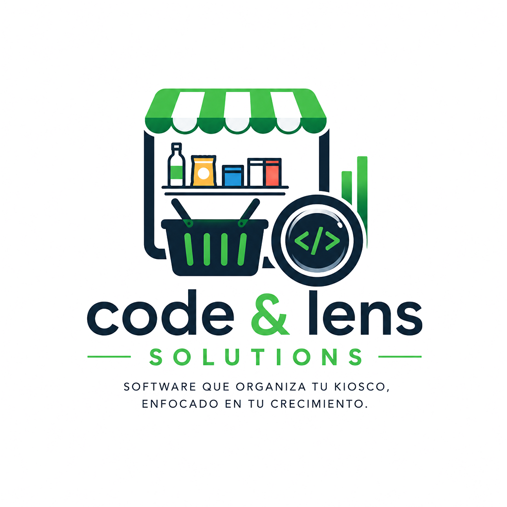

<p align="center">
  
</p>

<h1 align="center">App Kiosco · POS multiplataforma</h1>

<p align="center">
  Punto de venta offline-first para comercios chicos · Offline-first point of sale for small retail businesses
</p>

<p align="center">
  
  
  
  
  
  
</p>

<p align="center">
  <a href="#-español">Español</a> · <a href="#-english">English</a>
</p>

---

## 🇪🇸 Español

### Qué es

**App Kiosco** es el cliente de punto de venta del SaaS multi-tenant de gestión comercial de **Code & Lens Solutions**, pensado para kioscos, minimercados y comercios chicos de Argentina. Funciona en **Android, Windows, Linux, macOS, iOS y Web** desde una única base de código Flutter, y sigue vendiendo aunque se corte internet.

### Funcionalidades

- **Ventas (POS):** carrito, lectura de códigos de barras con la cámara y cobro con terminales **Mercado Pago Point**.
- **Escáner remoto:** se empareja un celular por QR y se usa como lector de códigos para la caja.
- **Modo offline:** base local SQLite (Drift), cola de operaciones pendientes y sincronización automática al recuperar conexión.
- **Tiempo real:** actualizaciones vía WebSockets (Laravel Reverb / protocolo Pusher).
- **Caja:** apertura, cierre, movimientos y sesiones de POS por dispositivo.
- **Stock y artículos:** ABM, movimientos de stock, productos más vendidos.
- **Clientes y proveedores:** cuentas corrientes y estadísticas.
- **Compras, remitos, presupuestos y notas de crédito.**
- **Empleados:** usuarios por comercio y comisiones.
- **Reportes** de ventas y caja.
- **Multi-tenant:** una misma cuenta puede operar varios comercios; login con email o Google.
- **Suscripciones** gestionadas con Mercado Pago.

### Arquitectura

```
lib/
├── core/          # red (Dio), realtime, offline (Drift + sync), tema, widgets comunes
├── models/        # modelos de dominio
├── services/      # *_api_service (HTTP) + *_repository (API + caché local)
├── providers/     # estado con Riverpod
├── controllers/   # lógica de pantallas (carrito, caja, ventas, sync…)
└── screens/       # una carpeta por módulo
```

Capas **API service → repository → provider → controller → screen**. El backend es una API REST en Laravel (Sanctum) compartida con otras apps del ecosistema.

### Cómo correrlo

```bash
git clone https://github.com/ClaudioParedesArbeloDev/appKiosco.git
cd appKiosco
flutter pub get
dart run build_runner build   # genera el código de Drift
flutter run                   # o: flutter run -d windows / linux / chrome
```

Crear un archivo `.env` en la raíz con las variables de configuración (IDs de cliente de Google, URL de la API, etc.).

> ℹ️ La app necesita el backend de Code & Lens para funcionar. El código se publica como portfolio.

---

## 🇬🇧 English

### What it is

**App Kiosco** is the point-of-sale client of **Code & Lens Solutions**' multi-tenant retail management SaaS, built for small shops and convenience stores in Argentina. One Flutter codebase runs on **Android, Windows, Linux, macOS, iOS and Web**, and it keeps selling when the internet goes down.

### Features

- **Sales (POS):** cart, camera barcode scanning and **Mercado Pago Point** card terminals.
- **Remote scanner:** pair a phone via QR code and use it as the register's barcode reader.
- **Offline mode:** local SQLite database (Drift), pending-operations queue and automatic sync on reconnect.
- **Real time:** live updates over WebSockets (Laravel Reverb / Pusher protocol).
- **Cash register:** open/close, cash movements, per-device POS sessions.
- **Inventory:** products, stock movements, best sellers.
- **Customers & suppliers:** current accounts and statistics.
- **Purchases, delivery notes, quotes and credit notes.**
- **Employees:** per-store users and commissions.
- **Sales and cash reports.**
- **Multi-tenant:** one account can run several stores; email or Google sign-in.
- **Subscriptions** handled through Mercado Pago.

### Architecture

Layered: **API service → repository → provider (Riverpod) → controller → screen**, talking to a Laravel (Sanctum) REST API shared by other apps in the ecosystem.

### Running it

```bash
flutter pub get
dart run build_runner build
flutter run
```

Add a `.env` file at the project root with the configuration values (Google client IDs, API URL, etc.).

> ℹ️ The app needs the Code & Lens backend to run. The code is published as a portfolio piece.

---

<p align="center">
  Hecho por / Built by <a href="https://github.com/ClaudioParedesArbeloDev"><b>Claudio Paredes Arbelo</b></a> · <a href="https://www.claudioparedes.site">Code & Lens Solutions</a>
</p>
# app_kiosco

A new Flutter project.
